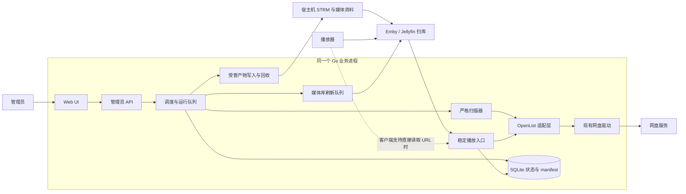

# 网盘 STRM 中间件实现方案

> 版本：v1.1｜状态：用户已审核，实施中｜作者：long
> 日期：2026-11-17（北京时间）
> 产品要求：开源免费、自行维护、一个 Go 业务进程、一个部署容器、多网盘接入、Emby/Jellyfin 播放。
> 审核入口：[路线图](ROADMAP.md)。本方案替代外层 `STRM-MIDDLEWARE-PRD.md` v0.3 中的技术实现描述；服务器部署历史仍参考外层 `OPENLIST-OPS.md`，不视为本轮实测。

> 实施状态（2026-11-17）：M0已通过本机/amd64容器smoke；M1草稿/只读预览、M2手动生成与签名代理、M3两轮缺失预览/可恢复回收/恢复已有本地Local容器验收。真实网盘、Emby/Jellyfin验收、永久清理预览/执行、Cron与任务级完整动作恢复仍未完成。详见路线图和开发说明。

## 1. 结论与版本基线

本节表格保留方案审核时的基线证据；实施后的来源与验证见[上游记录](UPSTREAM.md)和[开发说明](DEVELOPMENT.md)，不把历史“尚未构建前端”当作当前状态。

**当前 Fork 可以作为开发基线，建议保留，不回退到 v4.2.9。** 当前代码是上游 main 的固定提交，不应称为已经验收的稳定发行版。后续只在明确的上游升级窗口更新基线，不能让构建自动追随 main、latest 或 rolling。

| 项目 | 本轮已验证结果 |
| --- | --- |
| 实际仓库 | `/Users/long/Documents/CodexProjects/wangpan/OpenList` |
| Fork 远端 | `https://github.com/lonnnnnng/OpenList` |
| 分支与提交 | `main`，`de1cdb3a054628f32c410a79571848c052ce7cc2` |
| 与官方关系 | 核验时官方 `OpenListTeam/OpenList` main/HEAD 为同一提交 |
| 原方案基线 | 官方 v4.2.9 对应 `0497ee853853eff5fc0ada9f21684a990887de83` |
| 相对原基线 | 31 个提交，121 个文件变化；不能继续沿用原方案全部源码行号与假设 |
| Go 声明 | `go 1.26.4`，`toolchain go1.27.3`；上游 CI 使用 Go 1.27.3 |
| 本轮 Go | Go 1.27.4，macOS arm64 |
| macOS 后端 | `go build -mod=readonly -trimpath -tags=jsoniter` 通过 |
| Linux amd64 后端 | `CGO_ENABLED=0`、`GOOS=linux`、`GOARCH=amd64` 同参数构建通过；`file` 显示静态链接 ELF x86-64 |
| 上游相关测试 | db、transcode、media、fs、handles、common、torrent 全部通过，含这些路径的子包 |
| 锁文件 | 验证后 `go.mod`、`go.sum` 无变更 |
| 前端 | `public/dist` 只有 README 占位；尚无本地前端源码与 `index.html` |

这些结果证明后端基线可以编译、相关已有测试通过，**不证明完整 Web 产品已可运行，也不证明四个真实网盘账号已通过播放验收**。本轮没有连接家庭服务器、修改容器、操作网盘文件或复用生产数据库。

当前版本已有令牌轮转持久化、SQLite WAL、对象读取错误传播等修复，值得保留；仍需新增业务层处理任务生命周期、输出一致性和删除安全。

### 1.1 审核后的版本管理

1. 已从上述固定提交建立 `feat/strm-middleware` 开发分支；当前开发改动尚未提交或推送。
2. 保留上游 Go module 路径，避免一开始批量改 import；产品名称、镜像名称、版本单独维护。
3. 后端保留上游目录结构。新增代码集中放置，必要的上游修改单独记录。
4. 在 `docs/strm/UPSTREAM.md` 登记上游提交、前端来源/提交、依赖版本、每处集成修改及验证结果。
5. 首个产品发行版建议 `v0.1.0`，同时展示产品版本、上游提交、前端提交；名称待定，不冒用官方项目身份。

## 2. 产品范围

### 2.1 一期交付

- 四个网盘：夸克 → 阿里云盘 → 百度网盘 → UC；同一进程内调用 OpenList 驱动，不要求另部署 OpenList、OStrm 或 MediaWarp。
- 管理 Web UI：中文优先、仅管理员使用；家人仍通过 Emby/Jellyfin 看视频，已由用户确认。
- 存储管理：添加、编辑、禁用、连接检查、凭据失效提示；沿用上游认证方式，不另造一套网盘登录实现。
- 目录选择与 STRM 任务：草稿、预览、手动执行、定时执行、启停、取消、重试、运行历史。
- 本地输出：保留目录层级、内容幂等、原子写入、稳定路径映射、可选字幕与同目录媒体资料同步。
- 安全删除：完整扫描确认、任务所有权校验、默认回收、恢复、过期回收项预览与受控清理。
- 播放：专用稳定 URL、强制本机代理、Range/HEAD、拖动与续播；取链、请求头和数据流复用 OpenList。
- 媒体服务器：多个 Emby/Jellyfin 实例配置、任务绑定、连接检查、刷新去重、失败重试。
- 部署与维护：单容器 linux/amd64 发布、独立数据与输出目录、固定构建、备份、升级与恢复文档。

### 2.2 一期边界

1. 不要求四个网盘都能 302 到 CDN，不承诺所有账号免费高速原画。软件免费与网盘会员、限速、授权准入是不同条件。
2. 中间件不新增转码引擎；Emby/Jellyfin 可以保留自己的转封装、转码能力，不能为了宣称直连而强制关闭。
3. 新任务系统不调用云端上传、移动、改名、转存、删除接口；同步删除仅处理本地受管产物。
4. 不实现 TMDB 整理、追更、资源搜索、云端洗版、多用户分享、Plex、公网自动部署或动态插件系统。
5. 不把 OpenList 自带媒体库及兼容 Emby API 改造成另一个媒体服务器。该模块与本产品对接已有 Emby/Jellyfin 是不同方向。
6. 正式发布只要求 linux/amd64；macOS arm64 用于本地开发和测试，不因本机架构改变首发平台。
7. 网盘根目录允许读取；输出根目录由管理员在系统设置中指定，任务只能选择其下独立子目录。

## 3. 复用与自建边界

| 能力 | 决策 | 当前依据 |
| --- | --- | --- |
| 网盘驱动、登录、轮转令牌 | 复用 | `drivers/`、`internal/op/storage.go` |
| 存储模型与配置界面字段 | 复用 | `internal/model/storage.go`、现有 storage/driver API |
| 原生对象与链接获取 | 包装复用 | `op.GetUnwrap`、`op.Link`，不能用手工构造对象替代原生对象 |
| Range、HEAD、请求头与流关闭 | 复用底座 | `server/common/proxy.go`、`internal/net/`、`model.Link` |
| 数据库连接与基础迁移 | 复用 | `internal/db/db.go`；按实际表前缀创建新表 |
| 管理员认证 | 复用 | `/api/auth/login`、`Auth`、`AuthAdmin` |
| 任务状态、执行队列、恢复 | 自建 | 自有持久状态和取消契约，避免绑定上游整段任务快照格式 |
| 目录扫描完整性 | 自建严格适配层 | 普通 `fs.List` 在部分虚拟挂载情况下可能吞掉父存储错误 |
| 本地产物与删除规则 | 自建 | 内置 STRM sync 会清理无 manifest 保护的额外文件/目录 |
| STRM URL 与签名 | 自建业务入口，复用密码学底层 | 文件 ID 入口、独立播放密钥、可撤销状态 |
| 媒体服务器刷新 | 自建 | 双服务器适配器与持久刷新队列 |
| Web UI | 引入固定前端源码后扩展 | 当前后端仓库没有前端源码 |

不直接复用 `drivers/strm/hook.go` 的本地写入/删除流程，也不直接使用 `internal/media/strm.go` 的 VFS 输出作为本产品文件写入器。可以参考其扩展名、编码等实现，但新产物必须遵守第 7～9 节契约。

## 4. 进程内架构



扫描链路与播放链路共享驱动和账号级限流，但分别控制并发。STRM 保存稳定入口；临时网盘 URL、Cookie 与 UA 不写入 STRM。媒体服务器或客户端访问入口时，才获取当前链接。

### 4.1 目录与最小集成点

| 新模块/文件 | 责任 |
| --- | --- |
| `internal/strm/source.go` | 将 storage ID、源相对路径、原生对象、链接、错误封装成严格读取契约 |
| `internal/strm/scanner.go` | 目录队列、强制刷新、扫描记录、完整性标记、过滤 |
| `internal/strm/planner.go` | 比较快照与 manifest，生成新增/更新/缺失/冲突计划 |
| `internal/strm/writer.go` | 边界校验、临时文件、原子替换、内容校验、产物登记 |
| `internal/strm/trash.go` | 回收/恢复/到期清理；只处理登记产物 |
| `internal/strm/runner.go` | 自有运行队列、互斥、取消、统计、崩溃恢复 |
| `internal/strm/scheduler.go` | Cron、时区、下次运行时间、错过执行合并 |
| `internal/strm/sign.go` | 专用播放签名、密钥持久化、文件级撤销 |
| `internal/model/strm.go`、`internal/db/strm*.go` | 持久模型与数据库读写；业务包调用db，db不反向导入业务包 |
| `internal/mediaserver/` | Emby/Jellyfin 连接、刷新、错误分类与出站队列 |
| `server/handles/strm_*.go` | 任务、浏览、预览、运行、回收、媒体服务器 API |
| `server/handles/strm_stream.go` | 稳定文件 ID 入口，复用 `common.Proxy` |
| `server/strm_routes.go` | 新路由集中登记；在现有 router 注册点接入 |
| `internal/bootstrap/strm.go` | 初始化、存储加载后的恢复、关停顺序 |
| `web/` | 固定来源的前端源码、锁文件及新增业务页面 |
| `scripts/build-strm.*`、`Dockerfile.strm` | 独立、可重复的产品构建；不运行浮动下载与清理脚本 |

持久模型沿用 `internal/model` 的现有组织方式，业务包只消费 db 方法；`internal/strm` 内保留运行态对象与业务DTO。M0验证包依赖，不能让 `internal/db` 反向导入 `internal/strm` 形成循环。

上游必要改动预计集中在：模型迁移注册、启动/关停、路由登记、静态资源构建及少量公开适配辅助函数。发现驱动缺陷时允许单独做最小修复，并登记来源与回归；不强求“驱动零改动”而掩盖问题。

## 5. 存储接入与严格读取

### 5.1 一期认证矩阵

| 网盘 | 默认一期路径 | 可选路径与限制 |
| --- | --- | --- |
| 夸克 | `quark_uc`，Cookie，原文件代理 | QuarkTV、转码地址作为独立模式测试；不把转码流当作源文件原画 |
| 阿里 | `aliyundrive_open`，OAuth refresh token | 默认在线刷新服务与自有 ClientID/ClientSecret 分别说明；代理可能返回 RangeReader 而非 URL |
| 百度 | `baidu_netdisk`，OAuth refresh token | 不能照旧 PRD 写成该驱动要求 BDUSS/STOKEN；默认 official 下载模式，UA/速度按账号验证 |
| UC | `quark_uc` 的 UC 分支，Cookie，代理 | 当前分支有 OnlyProxy；UCTV 是另一模式，首发不承诺其 302 |

上游在线 token 刷新服务、TV token 换取服务是外部依赖；界面须说明会调用哪些服务及是否支持自有授权应用。免费开源不自动消除这些依赖，也不保证用户能申请到所有开放平台权限。

### 5.2 绑定与目录边界

1. 任务绑定 `Storage.ID`、驱动类型、非敏感根配置指纹和源相对路径；挂载名只用于展示。
2. 读取时按绑定 ID 查到当前配置，再核对运行驱动的 ID 与根指纹；存储被删除、禁用或换根时停止任务，禁止悄悄切到同名新挂载。
3. 一期只允许单个物理存储中的源目录，不跨越子挂载、不使用 alias/balanced 虚拟聚合目录；发现边界给出可拆分任务提示。
4. 严格扫描基于 `op.List` 包装，使用 `Refresh:true`、`SkipHook:true`，保留底层错误；不能用管理员首页的过滤后列表做删除快照。
5. 刷新仍可能涉及父对象缓存及上游 singleflight：M1 严格扫描器实现时验证缓存失效与取消等待，缺少公开辅助函数时做最小适配补充。M0的Local目录读取不替代这些测试。
6. 驱动返回成功是目录完整性的基本契约，不是独立证明网盘分页一定正确；逐驱动测试分页和空目录，并用两轮确认、大量消失保护抵御异常成功响应。

### 5.3 连接检查

界面区分“配置已保存”“认证有效”“目录可读取”“链接可获取”“实际播放已验收”。连接检查默认只读取指定目录；读取少量文件/Range 测试由管理员选择已知媒体文件执行，不修改云端。

## 6. 任务、调度与生命周期

### 6.1 任务字段

名称、存储、源目录、独立输出子目录、视频后缀、最小大小、伴生文件开关、播放入口前缀、Cron、时区、任务状态、自动调度开关、删除同步、回收保留天数、配置修订号、最近运行与下次运行。

默认：新任务处于draft，扫描并发 1，全局同时运行任务 1；媒体资料复制按需开启；回收保留 7 天；删除确认次数 2；首次运行先预览，再由管理员“启用并运行”。任务状态分draft/active/disabled；自动调度开关与任务状态独立，暂停Cron不会撤销已有播放入口，停用任务才同时阻止执行与播放。并发调高须经过账号与服务器验收，不沿用旧文档默认并发 4 的假设。

### 6.2 持久状态

```text
queued → running → succeeded / partial / failed
queued → canceled
running → canceling → canceled
running / canceling → interrupted（进程异常退出后恢复判断）
```

- 同一任务不能同时运行；输出目录不允许重叠；手动、Cron、重试走同一个入队入口。
- 重复触发返回现有运行信息；HTTP 重试按请求标识幂等，不制造两次扫描。
- 每次运行固定 task/config revision。运行中修改源、输出或过滤条件返回冲突，先取消或等待结束。
- 成功目录可生成新增/更新产物；任何目录失败均令本轮 partial，**整轮禁止缺失删除**。
- 取消检查放在目录请求前后、写文件前、回收前和提交状态前；不能在取消后继续产生删除动作。
- 部分老驱动/singleflight 可能无法即时响应 context；UI 显示“取消中”，不假称已经停止。M1扫描适配与M4逐盘验收验证取消/超时，需要时补最小驱动修复。
- 重启后将未完成运行标记 interrupted；先对账动作日志，再排队进行新扫描，不直接继续旧删除计划。

### 6.3 Cron 与队列

计划引入 `github.com/robfig/cron/v3`，使用标准五字段 Cron 与任务时区；在M3接入调度前锁定精确依赖版本，M0不预装未使用依赖。官方 README 已核对默认分钟字段与时区支持，见第 18 节。

Cron 只负责触发，实际执行由自有持久队列管理；不把上游 `pkg/cron` 的固定 duration ticker 当作表达式调度器。错过多次执行合并为一次，避免重启后集中刷盘；保存下次运行时间供 UI 预览。

不直接依赖 tache 的整段任务序列化来保存 manifest。上游 tache 管理器继续服务原有任务，新模块在同进程内有自己的明确状态契约，后续再评估统一展示。

### 6.4 启动与关停

初始化 DB/迁移/播放密钥 → 注册 STRM 服务 → 等待存储加载尝试完成 → 逐任务校验存储 → 恢复动作日志 → 启动调度。

关停顺序：拒绝新任务 → 停 Cron → 取消运行 → 在预算内等待并记录 interrupted → 停止刷新队列 → 等待播放请求退出 → 关闭 DB。建议关停预算 30 秒，与容器 stop grace period 配套，替换现有 CLI 仅 1 秒的网络关停假设。

不为无法退出的驱动循环无期限阻塞；超时后按异常中断路径恢复。提交数据库之前必须检查取消状态，不能以关停时最后一次快照作为删除依据。

## 7. 扫描、增量与产物规划

1. 创建 run 和递增 generation，记录配置 revision 与开始时间。
2. 有界目录队列遍历，逐目录保存成功/失败状态与错误；不把全库链接或视频内容载入内存。
3. 元数据优先使用远端 ID、版本/hash、size、mtime；不足时回退路径与 size/mtime，并标明识别能力下降。
4. 比较 manifest，规划新增、更新、未变、冲突和缺失候选。
5. STRM 内容摘要还包含入口前缀、播放签名版本与生成规则；不能只在视频 size/mtime 变化时更新 STRM。
6. 对成功读取的条目执行可恢复写入；对同一产物重复运行结果相同，不靠截断重写制造“更新”。
7. 扫描全成功且源边界一致，才提交完整 generation，并计算缺失；否则只保存 partial 结果。
8. 只有产生实际可见输出变化时发送媒体库刷新事件；刷新失败不撤销产物。

不下载整部视频计算 hash。只有网盘已有 hash/版本字段时使用；无法可靠识别改名时按新增与缺失处理，受回收保护。支持可靠远端 ID 的盘可以保留播放 file ID 并更新源路径。

### 7.1 文件命名与冲突

- 保留原目录层级，默认同名输出 `.strm`；源同目录存在同 stem 不同扩展名时，使用稳定来源摘要后缀区分。
- 输出实际相对路径落 manifest，后续不因遍历顺序改变而重新分配文件名。
- 处理中文、空格、百分号、`#`、超长 UTF-8 文件名；路径编码与本地文件名清洗分别处理。
- 未登记的同名本地文件视为冲突，保留并报错；禁止自动接管或覆盖。
- 字幕等按明确关联规则复制；没有可靠关联的 NFO/海报默认只在独占任务目录内处理，禁止无界扫描或猜测跨任务所有权。

### 7.2 配置变化

改变源、存储根、输出目录、过滤条件会使删除基线失效，必须重新预览并建新基线；旧产物保持受管记录，不能因为配置变了就批量清理。改变入口前缀、签名密钥或生成规则，安排幂等重写任务，即便源文件没有变化。

## 8. 文件与数据库一致性

数据库事务不能跨远端请求或长时间文件复制；manifest 分批短事务写入，降低与 token 刷新争用 SQLite 锁的概率。

所有写入、替换、回收、恢复均记录动作：

```text
planned → applying → committed / failed
```

写入动作：登记目标、旧摘要、新摘要及临时路径 → 在目标同目录写临时文件并校验/同步 → 再次检查目录与取消状态 → 原子 rename → 更新产物和动作状态。源版本与目标已改变时记录冲突，不强行覆盖。文件操作采用根受限接口或目录句柄约束，并拒绝符号链接；不能仅凭一次字符串前缀检查或Lstat后再用不受限路径操作，造成校验与写入之间的逃逸窗口。

异常重启后依据动作 ID、已登记的目标/临时路径和内容摘要对账；不能递归清空临时目录，更不能覆盖无法确认归属的文件。文件系统与数据库没有共同事务，动作日志用于恢复跨两者的中断，不宣称严格原子提交。

## 9. 安全删除、回收与恢复

### 9.1 删除资格

只有以下条件全部满足才允许回收：

1. 关联存储就绪、源根可读、根指纹未变、整轮目录扫描成功；失败、取消、过滤边界变化均不满足。
2. 产物属于本任务，manifest 有准确路径与最近已写内容摘要。
3. 文件连续两次完整扫描缺失，期间没有重新出现；首次基线不删除。
4. 大量消失保护未触发：建议缺失候选不少于 10 个且超过当前受管媒体数 20% 时暂停回收，要求查看预览后显式执行。
5. 输出目录独占且根边界通过检查；文件不是符号链接，路径不能逃逸。
6. 本地内容仍与登记摘要相同；管理员自行修改过的产物转为冲突，不能覆盖或回收。

数字为建议默认值，列入审核项。源根消失不能直接等同“整个库已删除”，先报源不可读并阻止删除。

### 9.2 回收目录

同一输出父目录划分 `library/` 与 `trash/`：容器挂载父目录，媒体服务器**只挂载 library**。实现使用同一受限输出根内的硬链接占位、摘要复核和源路径移除；中断后重试会按两侧路径和摘要对账，不覆盖目标。

回收路径包含 task ID、action ID 与原始相对路径，避免同名冲突；保存原路径、摘要、时间和原因。跨文件系统时采用校验过的复制流程，复制/落盘成功前不能删除原文件。

### 9.3 恢复与到期清理

恢复不覆盖现有文件；还原后文件仍属本任务。远端重新出现时可自动恢复未修改的匹配产物。远端仍缺失时允许管理员手动恢复，但明确提示播放可能失败。

一期提供按保留期筛选的清理预览与管理员执行，不做后台自动永久删除；永久删除仅限登记且内容未改变的回收产物。任何未知文件保留。任务删除默认只删除配置/停用入口，保留产物与回收索引；“连带回收产物”是另一个有预览的动作。

## 10. 稳定播放入口

### 10.1 URL 与鉴权

```text
http://192.168.1.2:5344/s/<file_uuid>?v=<file_token_version>&sign=<HMAC>
```

地址只是待部署的内网建议值，不是本轮已运行服务。入口前缀须显式配置并由媒体服务器可达性检查确认，不自动信任请求 Host；公网访问不属于一期验收。

- UUID 关联源路径和产物，而非把存储挂载路径放在公开 URL 中；数据库记录当前 source/storage revision。
- 使用独立播放密钥，持久保存在私有数据目录，权限 600；不与 OpenList 管理 API token 绑定。
- HMAC 绑定 file UUID、文件 token version 和只读播放作用域，GET/HEAD 共用；复用已有密码学原语与常量时间验证。
- 一期稳定入口不过期，通过文件状态、任务状态、token version 和密钥撤销；临时 CDN 地址仍然按驱动策略过期。
- 禁用任务/存储、回收文件或撤销播放 token 后入口不可继续使用；重新启用可恢复仍有效的受管条目。
- 密钥更换必须先备份并安排 STRM 重写/媒体库刷新；删除数据目录会丢失密钥与 file ID，因此它们必须共同备份。
- 管理日志、请求访问日志、错误详情、预览默认都不显示完整签名 URL、Cookie、Token 或网盘认证参数。

### 10.2 一期代理实现

专用 handler 完成鉴权 → 查询 file/任务状态 → 按 storage ID 核对源边界 → 以 `Redirect:false` 获取原生 `model.Link` 和对象 → 调用 `common.Proxy` → 正确关闭 Link。

不直接调用依赖 `conf.PathKey` 的 `handles.Proxy`，也不允许请求的 `force/d/type` 或全局 DownProxyURL 把一期请求意外改成 302。适配层保留 Header、RangeReader、ContentLength、并发、分片及引用关闭语义，尤其不能假设阿里代理模式一定返回裸 URL。

需要验证：GET/HEAD、完整和部分请求、正确的 Content-Range/Length、越界 Range 的 416、连续 seek、断点、客户端取消、零字节/无效媒体、重定向后上游请求头。

取链/访问在尚未发送响应字节时遇到可确认的过期错误，失效对应缓存并最多重新取链一次；不能统一把所有 403 当过期。响应已开始后不拼接另一份流，结束请求并记录可重试原因，由客户端后续 Range 恢复。

### 10.3 转码与客户端兼容

中间件负责提供字节流。网页、Android TV、Infuse 需要不同编解码支持；Emby/Jellyfin 探测及转码可能再次访问入口。允许媒体服务器按自身设置转封装/转码，测试同时记录播放方式与真实取流路径。

Direct Play 不能当作“流量没过服务器”的证据。后续 302 也要验证谁跟随跳转、最终 URL 是否要求 UA/IP/额外 Header、浏览器 CORS/HTTPS 是否可用。

## 11. Emby/Jellyfin 刷新

媒体服务器配置：名称、类型、服务地址、API Key、启用、连接状态、目标库 ID 与任务绑定。API Key 管理响应仅返回已配置状态；留空编辑保留，清空需要明确动作。

一期实现两类适配器，分别核对目标版本的连接/库枚举/刷新接口；不能仅因接口路径相似就宣布完整兼容。刷新结果分为“已受理”“已完成验收扫描”“失败”，普通 API 返回成功不等于扫描已完成。

文件动作提交后在同一短 DB 事务内写刷新 outbox；按服务器/库合并短时间重复请求，崩溃后可重试。刷新失败不回滚 STRM，任务结果显示“同步完成、刷新失败”，提供独立重试，不重扫网盘。

只触发管理员绑定的服务器，不为每个文件发一次全库刷新。媒体库目录新增或容器挂载仍需实际部署时配置，不通过 API 凭空建立宿主机卷。

## 12. 数据模型草案

| 表/实体 | 核心字段与约束 |
| --- | --- |
| `strm_task` | UUID、name、storage_id、driver/root fingerprint、source_relative_path、output_subdir、规则、schedule/timezone、state、schedule_enabled、config_revision、last_complete_generation、next_run_at |
| `strm_run` | UUID、task_id、trigger/request_id、config_revision、generation、status、完整性、时间、计数、错误摘要、cancel_requested_at；同任务活动运行互斥 |
| `strm_scan_dir` | run_id、目录身份/路径、状态、已列条目数、错误分类；用于说明完整扫描与失败范围 |
| `strm_file` | UUID、task_id、storage/remote identity、当前源相对路径、size/mtime/remote_version/hash、last_seen_generation、missing_confirmations、state、token_version |
| `strm_artifact` | UUID、task_id、file_id、kind、实际输出相对路径、内容摘要、版本、回收路径/时间、state；输出路径唯一且不能跨任务重叠 |
| `strm_action` | UUID、run_id、artifact_id、操作、原/新/临时路径、期望摘要、state、错误、时间；恢复文件系统与DB之间的中断 |
| `strm_media_server` | UUID、type、url、api_key、enabled、连接状态；密钥不出现在管理响应/日志 |
| `strm_task_media` | task_id、server_id、library_id、刷新开关；组合唯一 |
| `strm_refresh_event` | UUID、server/library、关联run、state、attempts、next_retry_at、last_error；刷新outbox |

这些是逻辑名称，实际表名遵守现有 GORM 表前缀；模型与升级由版本化迁移辅助代码管理。一期仅以 SQLite 验收，不宣称新业务在上游 MySQL/PostgreSQL 模式已受支持。

关键索引：task/run时间、run/status、file/task+源身份、file/last_seen_generation、artifact/output_path、action/state、refresh/state+next_retry_at。网络与磁盘长操作不持有 DB 事务。

运行详情支持分页、失败文件筛选；历史日志建议保留 30 天，可配置。历史清理只处理运行记录，不清空 manifest、未结束动作或回收索引。

## 13. 管理 API 草案

全部新管理 API 注册到现有 `Auth + AuthAdmin` 链；前端沿用当前 API 封装，当前 Authorization header 是原样 token，不能擅自改成 Bearer 格式。

| 方法与路径（前缀 `/api/admin/strm`） | 用途 |
| --- | --- |
| `GET/POST /tasks` | 分页任务列表、创建未启用草稿 |
| `GET/PUT/DELETE /tasks/:id` | 详情、带revision更新、默认保留产物的任务删除 |
| `POST /tasks/:id/preview` | 创建只读预览run，显示计划与风险，不写媒体产物 |
| `POST /tasks/:id/run` | 返回202与run_id；重复请求幂等，活动任务冲突可查看现有run |
| `POST /tasks/:id/enable`、`POST /tasks/:id/disable` | 草稿启用与显式停用；仅暂停自动调度通过更新schedule_enabled实现 |
| `POST /tasks/:id/cancel` | 请求取消，不把接受请求等同已取消 |
| `POST /tasks/:id/retry` | 新建重试run；删除确认必须重建完整扫描，不沿用局部失败重试结果 |
| `GET /tasks/:id/runs`、`GET /runs/:id` | 分页历史、实时进度与错误 |
| `GET /tasks/:id/files` | 受管文件、冲突、缺失状态与安全播放测试入口 |
| `GET /browse?storage_id=&path=` | 单存储严格目录选择；拒绝虚拟/越界源 |
| `GET /trash`、`POST /trash/:id/restore` | 分页回收列表、无覆盖恢复 |
| `POST /trash/cleanup-preview`、`POST /trash/cleanup` | 到期清理预览及与预览绑定的管理员动作 |
| `GET/POST /media-servers`、`PUT/DELETE /media-servers/:id` | 双媒体服务器配置与任务关联校验 |
| `POST /media-servers/:id/test`、`GET /media-servers/:id/libraries` | 连接检查与目标库选择 |
| `POST /media-servers/:id/refresh` | 手动/重试刷新；与同步任务解耦 |
| `GET/PUT /settings`、`GET /health` | 输出根、默认规则、并发、保留策略、运行状态 |

分页默认20、上限100；响应沿用现有 `code/message/data` 和分页风格。校验失败、版本冲突、源不可用、输出冲突、磁盘失败、刷新失败要有稳定错误分类，不把所有错误转成500。

已有 `/ping` 用于进程存活；产品新增最小 `/ready`，只说明DB/迁移、运行恢复和路由是否就绪，未就绪返回503。单个网盘认证失效通过管理员health与任务状态表达，不让整个产品因一个盘失败被反复重启。健康检查不暴露凭据、目录内容或完整签名URL。

任务执行、预览、删除清理采用服务端计划和配置 revision，不能信任前端提交的文件路径列表。进度一期用带退避的轮询，只有活动页面轮询；暂不引入 WebSocket/SSE 基建。

## 14. Web UI 与流程

### 14.1 前端组织

已将 `OpenList-Frontend` 固定提交的源码以可追踪导入方式放入同一个 Fork 的 `web/`，保留 MIT 许可、来源和锁文件；具体SHA与补丁见UPSTREAM记录。

保留 SolidJS 及上游 API/存储表单体系，不另起 React/Vue 重写登录和动态驱动表单。前端 pnpm/Node 精确版本以引入后的 packageManager/engines/锁文件为准，不沿用旧 v4.2.9 的版本数字。

构建后的前端以独立 `public/strm-bundle.zip` 内嵌Go二进制，并提供既有dist目录契约；保留上游public/dist与未知文件，避免构建清理误伤。安装时不依赖外网加载UI，运行时不额外启动Node服务。不开新视觉世界或营销页，一期以任务操作的清晰、状态准确和可恢复为目标。

### 14.2 页面范围

| 页面 | 用户操作与必须表达的状态 |
| --- | --- |
| 存储 | 现有驱动配置、认证方式、外部授权服务提示、就绪/失效/禁用、目录与取链检查 |
| 任务列表 | 名称、网盘、源/输出、启用、运行状态、最近结果、下次运行；运行/取消/查看失败 |
| 任务编辑 | 选择单个存储和目录 → 独占输出子目录 → 过滤/伴生规则 → 时间计划 → 删除/刷新设置 → 保存草稿 |
| 预览 | 新增/更新/缺失候选/冲突；是否允许删除；配置变化与大量消失保护原因；展开真实路径 |
| 运行详情 | 已扫描目录/文件、当前阶段、计数、失败项、取消中、刷新状态；未知总量不能显示伪百分比 |
| 回收区 | 原路径、任务、原因、回收时间、到期；恢复、冲突说明、到期清理预览 |
| 媒体服务器 | Emby/Jellyfin实例、连接测试、可选库、刷新失败独立重试 |
| 设置/日志 | 输出根、入口可达性、并发、保留天数、备份说明、脱敏运行日志 |

中文优先、只开放管理员管理；家人不需要中间件账号。多个媒体服务器实例仍属于管理员配置，不引入多用户权限系统。

### 14.3 交互验收

- 初次进入明确引导“添加存储 → 创建任务 → 预览 → 生成 → 媒体库扫描 → 播放检查”。
- 新任务默认草稿；保存不立即刷盘。连接失败、目录为空、扫描失败分别显示。
- 取消按钮请求后进入取消中；同步成功与刷新成功分开，失败重试不让用户重建任务。
- 删除任务、永久清理回收项及大量消失确认显示具体影响范围；普通编辑不增加无意义确认。
- 长路径允许展开/复制，错误附操作原因；敏感URL不进入列表或剪贴板默认内容。
- 桌面任务表格、手机单列详情；1440/390宽度验收，键盘可操作、焦点明确、表单错误关联字段，不能仅靠颜色表达状态。
- 若保留上游高级页面，明确入口与管理员身份；隐藏菜单不是禁用后端能力的措施。

## 15. 安全、部署与运维

### 15.1 产品默认配置

保留上游代码与结构，但产品默认只暴露需要的功能：关闭游客写入、离线下载工具、本地转码 worker、自动媒体扫描，以及一期不用的协议服务。能通过现有配置关闭就用配置；没有可靠开关的主动云端写入入口，增加集中路由开关并回归，而不是只裁菜单。

管理员仍可维护账号；新 STRM 任务始终只读云端。默认保留与审计 OpenList 管理身份，不新增公开管理API或匿名目录枚举。

凭据一期沿用上游 SQLite 存储方式，外加私有目录700/敏感文件600、接口不回显、日志脱敏和备份权限。文件权限不能写成“目录600”。字段加密是后续可选增强，需要单独设计主密钥、轮转与恢复；不能只加一个加密字段就宣称安全。

### 15.2 建议目录与访问

| 宿主机建议值 | 容器用途 | 媒体服务器用途 |
| --- | --- | --- |
| `/etc/openlist-strm` | 私有配置、DB、播放密钥，挂到 `/opt/openlist/data` | 不挂载 |
| `/home/lee/strm` | 挂到 `/data/output`，内部 `library/` 与 `trash/` | 只挂 `/home/lee/strm/library:/media/strm:ro` |
| `5344` | 产品 Web/API/稳定播放入口 | 由媒体服务器/客户端按实际网络访问 |

这些是方案默认值，部署前核对实际路径与端口；不修改现有5244实例。产物使用双方可读的共享组权限（建议目录750、文件640），不能为省事放宽私有凭据权限。

若 Jellyfin 当前缺少媒体卷，需要按实际 Compose 备份并重建；首次并行部署不替换现有媒体路径。同步任务与媒体库刷新、播放分别验收，不使用生产输出做首次删除测试。

### 15.3 构建与发布

1. 独立产品构建脚本，固定后端SHA、前端SHA、Go/Node/pnpm、运行镜像摘要及锁文件。
2. 当前后端已证明 CGO=0 Linux amd64 可构建，可优先走此路径；仍须验证最终加入前端/新依赖后的产物与容器运行。
3. 运行镜像提供 CA 证书、时区和必要网络环境，非 root 业务用户；不强制加入 ffmpeg/aria2 等额外守护进程。
4. 不执行现有 build.sh 的清理/删tag/sudo分支，不在构建中自动抓取 frontend latest/rolling，不沿用 alpine:edge 作为固定基础。
5. 产品CI只构建正式linux/amd64镜像；本地macOS测试保留。构建与发布分离，审核阶段不自动发布镜像或Release。
6. 发布附SHA256、来源提交、依赖清单、许可证、变更日志、升级与回滚注意事项。

### 15.4 备份与回滚

私有配置、播放密钥、DB及未完成动作必须共同备份。SQLite WAL模式不能只复制运行中的 data.db；使用一致性备份方法，或停止业务进程后备份DB/WAL/相关数据。视频不下载到本地，STRM可重建，但缺少manifest/密钥会改变入口与所有权判断。

迁移只增量新增业务表，不自动清空旧媒体表。不得共享生产OpenList的数据库文件；升级前保留完整副本，数据库已迁移时不能只换回旧二进制冒充完成回滚。

## 16. 测试与验收

| 层级 | 必须覆盖 |
| --- | --- |
| 单元 | 路径边界/符号链接/编码/冲突；配置revision；两轮缺失；大量消失保护；签名撤销；Cron/时区/重启合并 |
| 文件系统与DB集成 | 临时写失败、磁盘满、rename失败、回收跨设备、内容被改、未知文件、每个动作阶段中断后的对账 |
| 模拟驱动 | 分页失败、成功空目录、401/403、429、5xx、源根消失、目录缓存、取消、ID缺失与改名 |
| 代理 | GET/HEAD、200/206/416、Range字节准确、过期前取链重试、响应后断流、取消/资源关闭、Header传递、阿里RangeReader |
| 媒体服务器 | 两类连接/库枚举/刷新、超时/Key失效、重复刷新合并、重启后outbox重试 |
| UI | 任务从草稿到预览/运行/取消/重试/恢复全流程；空/错/长内容；桌面/手机/键盘；敏感字段脱敏 |
| 容器 | 首次启动、非root卷权限、重启保留、优雅退出、升级/恢复、固定前端离线可加载 |
| 真实网盘 | 四盘各1部电影+1集剧；账号/会员/模式/文件编码记录；播放至少30分钟、至少3次seek、停播后续播、上游取链恢复 |
| 真实客户端 | Jellyfin Web/Android TV、Emby至少一种客户端、Infuse Emby模式；编解码不兼容样本允许媒体服务器转码并记录链路 |

真实删除测试只使用明确的测试目录，先检验“扫描异常不删除、未知文件不动、两轮回收、恢复”。远端测试文件删除需在部署验收阶段确认具体目标，不把本方案审核视为任意云端删除授权。

资源目标：关闭无关worker后空闲内存目标低于200MiB，扫描队列和DB批次有界；播放带宽/CPU/峰值内存按真实文件与并发记录。本轮未测资源占用，不把历史21MiB当验收数据。

## 17. 二期与后续

二期先扩展115、天翼、迅雷，并沿用一期的连接/生成/播放/失败恢复清单。驱动存在不等于账号与播放已经通过验收。

随后实现能力化自动策略 `proxy / redirect / auto`：按驱动、认证模式、资源类型、UA/IP/Header约束选择；不从“URL非空”推断可直连。既有客户端支持直接读取稳定URL时先验证原生链路，不一律加播放拦截层。

确需对媒体服务器播放请求反代时，在同一个Go进程内增加独立监听端口与映射模块，保留转码回退及状态/字幕请求。该模块是二期单独里程碑，不为一期代理播放强行实现复杂协议重写。

再后续考虑公网HTTPS、更多网盘、凭据加密、多用户、Webhook、订阅/整理。它们不作为一期必做，不以“模块都在OpenList里”自动开放。

## 18. 证据、验证命令与待审项

### 18.1 关键源码位置（本轮HEAD）

| 位置 | 直接支持的事实 |
| --- | --- |
| `go.mod:3`、`.github/workflows/build.yml:14` | 工具链声明与已有测试入口 |
| `internal/bootstrap/run.go:33`、`cmd/server.go:20` | 启动、存储加载与DB关闭/关停插点 |
| `internal/bootstrap/sqlite_driver_glebarez.go:10` | 已有WAL/busy timeout配置 |
| `internal/fs/list.go:19` | 部分VFS列表错误可能被虚拟目录与过滤覆盖 |
| `internal/op/fs.go:26`、`:237` | 物理存储列表、代理/redirect/IP/UA链接缓存分离 |
| `internal/model/args.go:21` | LinkArgs与Link的Header/RangeReader/引用生命周期 |
| `server/common/proxy.go:19` | 可复用的代理底座 |
| `server/handles/down.go:46` | 原有代理handler依赖路径context与DownProxyURL策略 |
| `drivers/strm/hook.go:149`、`:192` | 原本地写入与无manifest的sync清理边界 |
| `internal/media/strm.go:42` | 自带媒体STRM输出为VFS路径，非本产品安全写入器 |
| `server/router.go:160`、`server/middlewares/auth.go:17` | 现有管理员路由与原样token认证 |
| `public/public.go:5`、`public/dist/README.md:1` | 静态资源嵌入与前端占位 |
| `build.sh:21`、`:99`、`Dockerfile:4` | 现有构建的浮动依赖及清理行为，需要独立管线 |

源码行号只对应本轮固定HEAD；后续实现后会变动。外部协议依据：

- [Emby STRM](https://emby.media/support/articles/Strm-Files.html)、[播放方式](https://emby.media/support/articles/DirectPlay-Stream-Transcoding.html)。
- [Jellyfin 客户端编码支持](https://jellyfin.org/docs/general/clients/codec-support/)、[当前Web播放选路源码](https://github.com/jellyfin/jellyfin-web/blob/master/src/components/playback/playbackmanager.js)：当前master实现不能代替目标发行版验收。
- [robfig/cron 官方README](https://github.com/robfig/cron/blob/master/README.md)：五字段/时区路线，本轮已抓取正文；版本在M0锁定。
- 各网盘认证/取链以本仓库绑定HEAD的驱动为当前实现依据，网盘服务本身的可用性仍需真实账号测试。

### 18.2 本轮实际执行

```zsh
# long: 先验证后端基线，输出到临时目录，避免覆盖用户前端或运行数据。
go build -mod=readonly -trimpath -tags=jsoniter -o /tmp/wangpan-openlist-baseline-de1cdb3a .
# long: 核验首发架构是否允许无CGO构建，避免把纯Go SQLite等同于整个项目无CGO。
CGO_ENABLED=0 GOOS=linux GOARCH=amd64 go build -mod=readonly -trimpath -tags=jsoniter -o /tmp/wangpan-openlist-linux-amd64-de1cdb3a .
# long: 沿用上游CI已选择的相关测试，验证当前扩展所依赖的数据库、流和媒体基础。
go test ./internal/db/... ./internal/transcode/... ./internal/media/... ./internal/fs/... ./server/handles/... ./server/common/... ./pkg/torrent/...
```

执行cwd为本仓库，上述构建和测试均通过。首次构建下载了go.mod/go.sum约束的依赖，不修改锁文件。未执行完整前端构建、Docker运行、真实网盘/服务器验收、全仓测试或发布。

### 18.3 请审核的具体选择

| 项目 | 方案默认值 | 状态 |
| --- | --- | --- |
| 开源/免费/单体 | AGPL-3.0、全部自建功能免费、同进程同容器 | 用户已确认方向 |
| 管理界面 | 中文优先、仅管理员；家人用媒体服务器 | 用户已确认 |
| 网盘首发 | 夸克、阿里、百度、UC；115/天翼/迅雷二期 | 用户已审核 |
| 首发播放 | 本机代理；不新增转码引擎，允许媒体服务器转码 | 用户已审核 |
| 前端组织 | 固定上游源码导入同仓库web/，保留SolidJS与MIT来源 | 用户已审核，M0已导入 |
| 删除策略 | 两次完整扫描、回收7天、大量消失保护、永久清理手动执行 | 用户已审核，后续里程碑实现 |
| 账号凭据 | 一期沿用上游存储，严格权限/脱敏，公开授权服务依赖 | 用户已审核，M0建立基础保护 |
| 部署 | 新实例5344、独立DB、输出父目录分library/trash | 建议值，实际部署前核对 |
| 资源与调度 | 全局任务并发1、每任务扫描并发1、标准五字段Cron | 用户已审核 |
| 实施顺序 | 先M0～M2夸克闭环，再可靠同步与四盘、双服务器、发布 | 用户已审核，实施中 |

用户已审核完整方案并要求开工。该审核授权业务实现与独立本地测试；真实家庭服务器部署、具体云端删除和正式发布仍分别核对目标。
